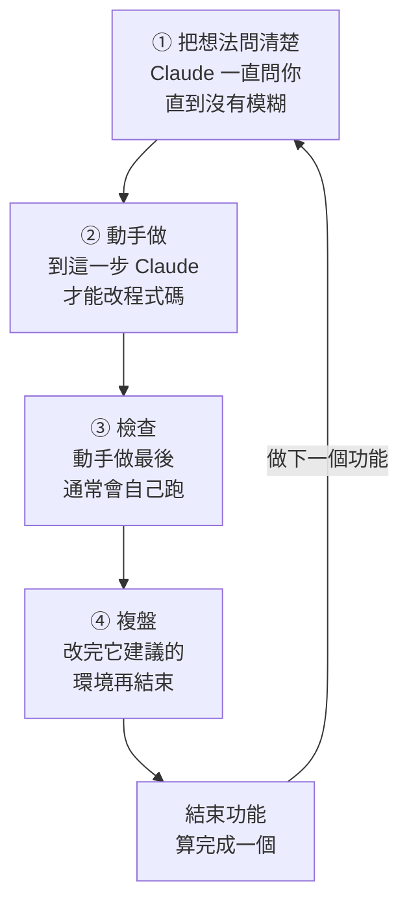

# 從零開一個新專案

從一個空資料夾開始，用 matt-flow 做完第一個功能。照順序做，每一步都只有一兩行指令。已經有專案的話，先看最後的「在現有的專案試用」。

## 1. 確認兩個 plugin 都裝好了

每台電腦只要裝一次。在終端機輸入：

```bash
claude plugin list
```

要看到這兩個：

```
❯ mattpocock-skills@claude-plugins-official
    Status: ✔ enabled
❯ matt-flow@skills-dir
    Status: ✔ loaded
```

用 `/plugin install` 裝的 matt-flow 會顯示成 `matt-flow@matt-flow`，一樣可以用。少了哪一個，就照 [README](../README.md) 的「前置條件」或「安裝 matt-flow」裝好。

## 2. 建專案資料夾

```bash
mkdir ~/my-app
cd ~/my-app
git init
git commit --allow-empty -m "init"
```

`my-app` 換成你的專案名稱。最後一行先建一個空的 commit，之後「檢查」時 Claude 才有起點可以比對。

## 3. 開 Claude Code

```bash
claude
```

第一次在這個資料夾開，它會問你信不信任這個資料夾，選信任（Yes）。

這時 matt-flow 還不會出聲：沒設定過的專案，它不擋也不提示。

## 4. 設定專案（每個專案一次）

在 Claude Code 裡輸入：

```
/setup-matt-pocock-skills
```

它會問你幾個問題，每題都會先給建議答案：

- **要建 CLAUDE.md 還是 AGENTS.md**：選 `CLAUDE.md`，Claude Code 每次都會讀它。
- **任務卡放在哪裡（issue tracker）**：一個人做、還沒有 GitHub repo，就選「Local markdown」，任務卡會存成專案裡 `.scratch/` 的檔案。
- **其他問題**：照它的建議答就好。
- 最後它會列出要寫的檔案，等你回覆：輸入 `go`，它才會寫。

設定完會多出 `docs/agents/` 資料夾。matt-flow 看到裡面的 `issue-tracker.md`，就開始管這個專案，狀態列會出現下一步的指令。

## 5. 做第一個功能

新專案一開始是 🌱 新手等級，一個功能這樣走：



| 步驟 | 指令 |
| --- | --- |
| ① 把想法問清楚 | `/grill-with-docs` |
| ② 動手做 | `/implement` |
| ③ 檢查 | `/mattpocock-skills:code-review`（`/implement` 最後通常會自己跑，跑過就算） |
| ④ 複盤 | `/retro` |
| 結束功能 | `/matt-flow end`（複盤改完之後；直接打 `/grill-with-docs` 開始下一個也可以） |

在指令後面直接寫你的想法，例如 `/grill-with-docs 我想做一個讓同事登記請假的頁面`。

「檢查」開始時，Claude 可能先問要跟哪個 commit 比對：選它推薦的，也就是第 2 步建的 `init`。

每一步開始時，面板顯示 ▶ 進行中；**你打下一步的指令，這一步才通過（✔）。** 看得出這一步做完時（例如檢查跑完了），下一步的指令會以灰字出現在輸入框，按 Tab 收下、再按 Enter。灰字有時是 Claude Code 自己的建議（例如設定完會出現 `commit these setup files`），不一定是下一步：**以狀態列為準**，照它寫的指令打。有兩步要你自己決定什麼時候定案，不會自動填：

- 「把想法問清楚」：你覺得問清楚了，自己輸入 `/implement`。新手等級在這一步和「動手做」之間不要清空對話，動手做靠的就是前面問清楚的內容。
- 「複盤」：改完複盤建議的環境，輸入 `/matt-flow end`，功能才算完成。

在「動手做」之前叫 Claude 改程式碼，會被擋下來。這是正常的：matt-flow 要你先把想法問清楚再寫程式。Claude 會停下來，告訴你該打的指令。跳步的指令也會被擋，畫面會告訴你下一步是什麼，見 README 的[跳步會被擋下](../README.md#跳步會被擋下)。

中途想停，直接關掉 Claude Code 就好，進度會留著，下次接著做。

## 常用指令

輸入 `/matt-flow` 打開面板看進度，卡住時按面板上的「? 我卡住了」。總覽（看所有專案）、跳過、結束、關掉這些指令，見 README 的[跳過、結束、關掉](../README.md#跳過結束關掉)；面板的用法見[面板](../README.md#面板)。

很小的改動（例如改一行字）：先打 `/matt-flow skip` 跳過「把想法問清楚」，再打 `/implement 把按鈕改成藍色`。做完記得把功能走完或結束，不然程式碼會一直解鎖。

進度存在這台電腦上，關掉 Claude Code 也不會不見。熟了以後，可以在面板換成 🚀 進階或 👑 高手，差別見 README 的[等級](../README.md#等級)。

## 在現有的專案試用

已經有專案的話，跳過第 2 步：在專案的根目錄打 `claude`，從第 3 步開始。設定之前先知道三件事：

- 設定會新增 `docs/agents/`，也會改專案的 `CLAUDE.md`（沒有的話會問你要不要建）。專案連著 GitHub 時，它會建議把任務卡放在 GitHub Issues，還可能在那個 repo 建 label；只是試用的話選「Local markdown」，就不會動到 GitHub。
- 設定完，Claude 改程式碼就會被擋，要等某個功能走到「動手做」。臨時要改別的，用 `/matt-flow off`，改完再 `/matt-flow on`。
- 不喜歡的話，刪掉設定加的 `docs/agents/`，把 `CLAUDE.md` 改回原樣，matt-flow 就不會再管這個專案：它看 `docs/agents/issue-tracker.md` 在不在。設定不會幫你 commit，所以開分支也擋不住這些檔案。
