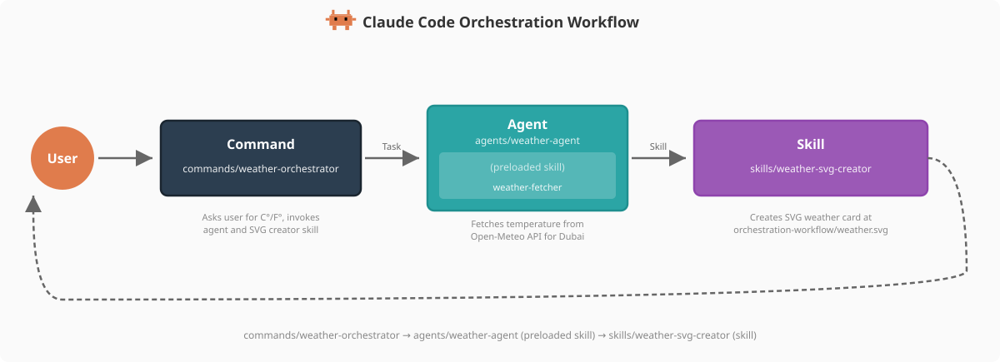

# Commands 實作


<table width="100%">
<tr>
<td><a href="../">← 回到 Claude Code 最佳實踐</a></td>
<td align="right"></td>
</tr>
</table>

> 英文原文：[`implementation/claude-commands-implementation.md`](https://github.com/kevin801221/claude-code-best-practice/blob/main/implementation/claude-commands-implementation.md)

---

<a href="#weather-orchestrator"></a>

天氣編排命令在這個 repo 中被實作為 **Command → Agent → Skill** 架構模式的進入點，示範命令如何編排多步驟工作流。

---

## Weather Orchestrator

**檔案**：[`.claude/commands/weather-orchestrator.md`](https://github.com/kevin801221/claude-code-best-practice/blob/main/.claude/commands/weather-orchestrator.md)

```yaml
---
description: Fetch weather data for Dubai and create an SVG weather card
model: haiku
---

# Weather Orchestrator Command

Fetch the current temperature for Dubai, UAE and create a visual SVG weather card.

## Workflow

### Step 1: Ask User Preference
Use the AskUserQuestion tool to ask the user whether they want the temperature
in Celsius or Fahrenheit.

### Step 2: Fetch Weather Data
Use the Agent tool to invoke the weather agent:
- subagent_type: weather-agent
- prompt: Fetch the current temperature for Dubai, UAE in [unit]...

### Step 3: Create SVG Weather Card
Use the Skill tool to invoke the weather-svg-creator skill:
- skill: weather-svg-creator

...
```

這個命令編排了整個工作流：詢問使用者偏好的溫度單位、透過 Agent 工具呼叫 `weather-agent`，接著透過 Skill 工具呼叫 `weather-svg-creator` skill。

---

## 

```bash
$ claude
> /weather-orchestrator
```

---

## 

請 Claude 幫你建立一個 —— 它會在 `.claude/commands/<name>.md` 產生帶 YAML frontmatter 與內文的 markdown 檔

---

<a href="https://github.com/shanraisshan/claude-code-best-practice#orchestration-workflow"></a>

Weather orchestrator 就是 Command → Agent → Skill 編排模式中的 **Command**。它作為進入點 —— 處理使用者互動（溫度單位偏好）、把資料擷取委派給 `weather-agent`，並呼叫 `weather-svg-creator` skill 產生視覺輸出。

<p align="center">
  
</p>

| 元件 | 角色 | 在本 Repo 中 |
|-----------|------|-----------|
| **Command** | 進入點、使用者互動 | [`/weather-orchestrator`](https://github.com/kevin801221/claude-code-best-practice/blob/main/.claude/commands/weather-orchestrator.md) |
| **Agent** | 用預載 skill 抓資料（agent skill） | [`weather-agent`](https://github.com/kevin801221/claude-code-best-practice/blob/main/.claude/agents/weather-agent.md) 搭配 [`weather-fetcher`](https://github.com/kevin801221/claude-code-best-practice/blob/main/.claude/skills/weather-fetcher/SKILL.md) |
| **Skill** | 獨立產生輸出（skill） | [`weather-svg-creator`](https://github.com/kevin801221/claude-code-best-practice/blob/main/.claude/skills/weather-svg-creator/SKILL.md) |
