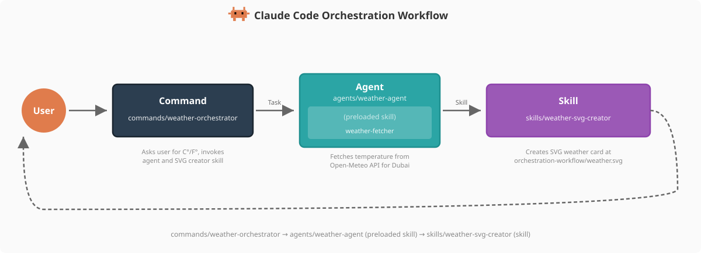

# 子代理實作


<table width="100%">
<tr>
<td><a href="../">← 回到 Claude Code 最佳實踐</a></td>
<td align="right"></td>
</tr>
</table>

> 英文原文：[`implementation/claude-subagents-implementation.md`](https://github.com/kevin801221/claude-code-best-practice/blob/main/implementation/claude-subagents-implementation.md)

---

<a href="#weather-agent"></a>

天氣代理在這個 repo 中被實作為 **Command → Agent → Skill** 架構模式的範例，示範了兩種不同的 skill 模式。

---

## Weather Agent

**檔案**：[`.claude/agents/weather-agent.md`](https://github.com/kevin801221/claude-code-best-practice/blob/main/.claude/agents/weather-agent.md)

```yaml
---
name: weather-agent
description: Use this agent PROACTIVELY when you need to fetch weather data for
  Dubai, UAE. This agent fetches real-time temperature from Open-Meteo
  using its preloaded weather-fetcher skill.
allowedTools:
  - "Read"
  - "Skill"
model: sonnet
color: green
maxTurns: 5
permissionMode: acceptEdits
memory: project
skills:
  - weather-fetcher
---

# Weather Agent

You are a specialized weather agent that fetches weather data for Dubai,
UAE.

## Your Task

Execute the weather workflow by following the instructions from your preloaded
skill:

1. **Fetch**: Follow the `weather-fetcher` skill instructions to fetch the
   current temperature
2. **Report**: Return the temperature value and unit to the caller
3. **Memory**: Update your agent memory with the reading details for
   historical tracking

...
```

這個代理有一個預載的 skill（`weather-fetcher`），提供從 Open-Meteo 擷取資料的指令。它把溫度數值與單位回傳給呼叫端命令。

---

## 

```bash
$ claude
> what is the weather in dubai?
```

---

## 

你可以用 `/agents` 命令建立代理：
```bash
$ claude
> /agents
```

或請 Claude 幫你建立一個 —— 它會在 `.claude/agents/<name>.md` 產生帶 YAML frontmatter 與內文的 markdown 檔

---

<a href="https://github.com/shanraisshan/claude-code-best-practice#orchestration-workflow"></a>

天氣代理就是 Command → Agent → Skill 編排模式中的 **Agent**。它從 `/weather-orchestrator` 命令接收工作流，用預載的 skill（`weather-fetcher`）擷取溫度。接著命令再呼叫獨立的 `weather-svg-creator` skill 產生視覺輸出。

<p align="center">
  
</p>

| 元件 | 角色 | 在本 Repo 中 |
|-----------|------|-----------|
| **Command** | 進入點、使用者互動 | [`/weather-orchestrator`](https://github.com/kevin801221/claude-code-best-practice/blob/main/.claude/commands/weather-orchestrator.md) |
| **Agent** | 用預載 skill 抓資料（agent skill） | [`weather-agent`](https://github.com/kevin801221/claude-code-best-practice/blob/main/.claude/agents/weather-agent.md) 搭配 [`weather-fetcher`](https://github.com/kevin801221/claude-code-best-practice/blob/main/.claude/skills/weather-fetcher/SKILL.md) |
| **Skill** | 獨立產生輸出（skill） | [`weather-svg-creator`](https://github.com/kevin801221/claude-code-best-practice/blob/main/.claude/skills/weather-svg-creator/SKILL.md) |
