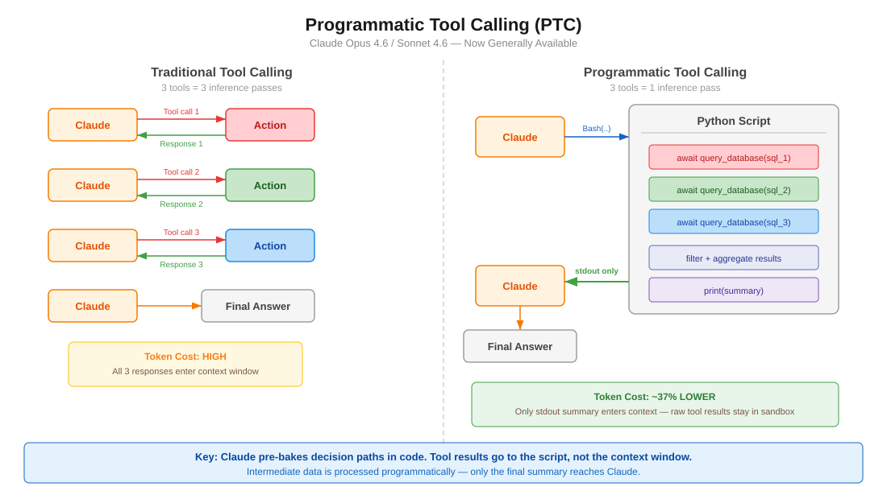

# Claude 進階工具使用模式

API 層級的功能（現已 GA），能減少 token 消耗與延遲，並提升工具使用準確度。隨 Opus/Sonnet 4.6 推出。

<table width="100%">
<tr>
<td><a href="../">← 回到 Claude Code 最佳實踐</a></td>
<td align="right"></td>
</tr>
</table>

> 英文原文：[`reports/claude-advanced-tool-use.md`](https://github.com/kevin801221/claude-code-best-practice/blob/main/reports/claude-advanced-tool-use.md)

## 目錄

1. [概觀](#概觀)
2. [程式化工具呼叫（PTC）](#程式化工具呼叫ptc)
3. [Web Search/Fetch 的動態過濾](#web-searchfetch-的動態過濾)
4. [Tool Search Tool](#tool-search-tool)
5. [工具使用範例](#工具使用範例)
6. [與 Claude Code 的關聯](#與-claude-code-的關聯)

---

## 概觀

| 功能 | 解決什麼問題 | Token 節省 | 可用性 |
|---------|---------------|---------------|--------------|
| 程式化工具呼叫（PTC） | 多步驟代理迴圈在來回往返上燒掉 token | 約減少 37% | API、Foundry（GA） |
| 動態過濾 | web search/fetch 結果用無關內容塞爆脈絡 | 輸入 token 約少 24% | API、Foundry（GA） |
| Tool Search Tool | 太多工具定義塞爆脈絡 | 約減少 85% | API、Foundry（GA） |
| 工具使用範例 | 單靠 schema 無法表達使用模式 | 準確率 72% → 90% | API、Foundry（GA） |

所有功能自 2026 年 2 月 18 日起**正式上線（GA）**。

**策略性疊加** —— 從你最大的瓶頸開始：
- 工具定義造成的脈絡膨脹 → Tool Search Tool
- 龐大的中間結果 → 程式化工具呼叫
- Web search 雜訊 → 動態過濾
- 參數錯誤 → 工具使用範例

---

## 程式化工具呼叫（PTC）



### 典範轉移

**之前（傳統工具呼叫）：**
```
使用者 prompt → Claude → 工具呼叫 1 → 回應 1 → Claude → 工具呼叫 2 → 回應 2 → Claude → 工具呼叫 3 → 回應 3 → Claude → 最終答案
```
每次工具呼叫都需要一次完整的模型來回。3 個工具 = 3 次推論。

**之後（程式化工具呼叫）：**
```
使用者 prompt → Claude → 寫 Python 腳本 → 腳本在內部呼叫工具 1、2、3 → stdout → Claude → 最終答案
```
Claude 寫出編排所有工具的程式碼。只有最後的 `stdout` 進入脈絡視窗。3 個工具 = 1 次推論。

### 運作方式

1. 你用 `allowed_callers: ["code_execution_20250825"]` 定義工具
2. Claude 寫出在沙箱中以 async 函式呼叫那些工具的 Python
3. 當工具函式被呼叫時，沙箱暫停，API 回傳一個 `tool_use` 區塊
4. 你提供工具結果 —— 它會送給**執行中的程式碼**，不是 Claude 的脈絡
5. 程式碼繼續執行、處理結果，必要時呼叫更多工具
6. 只有最終執行的 `stdout` 會到達 Claude

### 關鍵設定

```json
{
  "tools": [
    {
      "type": "code_execution_20250825",
      "name": "code_execution"
    },
    {
      "name": "query_database",
      "description": "Execute a SQL query. Returns rows as JSON objects with fields: id (str), name (str), revenue (float).",
      "input_schema": {
        "type": "object",
        "properties": {
          "sql": { "type": "string", "description": "SQL query to execute" }
        },
        "required": ["sql"]
      },
      "allowed_callers": ["code_execution_20250825"]
    }
  ]
}
```

### `allowed_callers` 欄位

| 值 | 行為 |
|-------|----------|
| `["direct"]` | 僅傳統工具呼叫（省略時的預設值） |
| `["code_execution_20250825"]` | 僅可從 Python 沙箱呼叫 |
| `["direct", "code_execution_20250825"]` | 兩種模式皆可 |

**建議：** 每個工具只選一種模式，不要兩種都開。這能給 Claude 更清楚的指引。

### 回應中的 `caller` 欄位

每個工具使用區塊都含有 `caller` 欄位，讓你知道它是怎麼被呼叫的：

```json
// 直接（傳統）
{ "caller": { "type": "direct" } }

// 程式化（來自 code execution）
{ "caller": { "type": "code_execution_20250825", "tool_id": "srvtoolu_abc123" } }
```

### 進階模式

**批次處理** —— 在 1 次推論中處理 N 個項目：
```python
regions = ["West", "East", "Central", "North", "South"]
results = {}
for region in regions:
    data = await query_database(f"SELECT SUM(revenue) FROM sales WHERE region='{region}'")
    results[region] = data[0]["revenue"]

top = max(results.items(), key=lambda x: x[1])
print(f"Top region: {top[0]} with ${top[1]:,}")
```

**提前終止** —— 一達到成功條件就停止：
```python
endpoints = ["us-east", "eu-west", "apac"]
for endpoint in endpoints:
    status = await check_health(endpoint)
    if status == "healthy":
        print(f"Found healthy endpoint: {endpoint}")
        break
```

**條件式工具選擇：**
```python
file_info = await get_file_info(path)
if file_info["size"] < 10000:
    content = await read_full_file(path)
else:
    content = await read_file_summary(path)
print(content)
```

**資料過濾** —— 減少 Claude 看到的量：
```python
logs = await fetch_logs(server_id)
errors = [log for log in logs if "ERROR" in log]
print(f"Found {len(errors)} errors")
for error in errors[-10:]:
    print(error)
```

### 模型相容性

| 模型 | 支援 |
|-------|-----------|
| Claude Opus 4.6 | 是 |
| Claude Sonnet 4.6 | 是 |
| Claude Sonnet 4.5 | 是 |
| Claude Opus 4.5 | 是 |

### 限制

| 限制 | 細節 |
|-----------|--------|
| **不支援 Bedrock/Vertex** | 僅 API 與 Foundry |
| **不支援 MCP 工具** | MCP connector 工具無法被程式化呼叫 |
| **不支援 web search/fetch** | PTC 中不支援網頁工具 |
| **不支援結構化輸出** | `strict: true` 的工具不相容 |
| **無法強制工具選擇** | `tool_choice` 無法強制使用 PTC |
| **容器壽命** | 約 4.5 分鐘後過期 |
| **ZDR** | 不在 Zero Data Retention 涵蓋範圍內 |
| **工具結果為字串** | 須驗證外部結果以防程式碼注入風險 |

### 什麼時候用 PTC

| 適合的情境 | 較不理想 |
|----------------|------------|
| 處理需要彙總的大型資料集 | 回應簡單的單次工具呼叫 |
| 連續 3 次以上有相依的工具呼叫 | 需要立即使用者回饋的工具 |
| 在 Claude 看到之前先過濾／轉換結果 | 非常快的操作（開銷 > 效益） |
| 跨多個項目的平行操作 | |
| 基於中間結果的條件邏輯 | |

### Token 效率

- 程式化呼叫的工具結果**不會加進 Claude 的脈絡** —— 只有最終 `stdout` 會
- 中間處理發生在程式碼中，不消耗模型 token
- 程式化呼叫 10 個工具 ≈ 直接呼叫 10 次所需 token 的 1/10

---

## Web Search/Fetch 的動態過濾

### 問題

Web search 與 fetch 工具會把完整的 HTML 頁面倒進 Claude 的脈絡視窗。其中大部分內容是無關的 —— 導覽列、廣告、樣板。Claude 接著對所有這些東西做推理，浪費 token 又降低準確度。

### 解法

Claude 現在會**寫並執行 Python 程式碼來過濾網頁結果**，再讓它們進入脈絡視窗。它不再對原始 HTML 做推理，而是在沙箱中過濾、解析並只抽取相關內容。

### 運作方式

**之前：**
```
查詢 → 搜尋結果 → 抓取 N 個頁面的完整 HTML → 所有內容進入脈絡 → Claude 對全部做推理
```

**之後：**
```
查詢 → 搜尋結果 → Claude 寫過濾程式碼 → 程式碼只抽出相關內容 → 過濾後的結果進入脈絡
```

### API 設定

使用更新版的工具類型，並帶 beta header：

```json
{
  "model": "claude-opus-4-6",
  "max_tokens": 4096,
  "tools": [
    {
      "type": "web_search_20260209",
      "name": "web_search"
    },
    {
      "type": "web_fetch_20260209",
      "name": "web_fetch"
    }
  ]
}
```

**需要的 header：** `anthropic-beta: code-execution-web-tools-2026-02-09`

搭配 Sonnet 4.6 與 Opus 4.6 使用新版工具類型時**預設啟用**。

### 基準測試結果

**BrowseComp**（在網站上找特定資訊）：

| 模型 | 無過濾 | 有過濾 | 提升 |
|-------|-------------------|----------------|-------------|
| Sonnet 4.6 | 33.3% | **46.6%** | +13.3 pp |
| Opus 4.6 | 45.3% | **61.6%** | +16.3 pp |

**DeepsearchQA**（多步驟研究，F1 分數）：

| 模型 | 無過濾 | 有過濾 | 提升 |
|-------|-------------------|----------------|-------------|
| Sonnet 4.6 | 52.6% | **59.4%** | +6.8 pp |
| Opus 4.6 | 69.8% | **77.3%** | +7.5 pp |

**Token 效率：** 平均減少 24% 輸入 token。Sonnet 4.6 成本下降；Opus 4.6 可能因過濾程式碼較複雜而略為上升。

### 使用情境

- 篩閱技術文件
- 跨多個來源驗證引用
- 交叉比對搜尋結果
- 多步驟研究查詢
- 找出埋在大頁面裡的特定資料點

---

## Tool Search Tool

### 問題

一開始就載入所有工具定義會浪費脈絡。如果你有 50 個 MCP 工具、每個約 1.5K token，那在使用者還沒開口前就已經用掉 75K token。

### 解法

把不常用的工具標上 `defer_loading: true`。它們不會出現在初始脈絡中，Claude 會透過 Tool Search Tool 按需探索它們。

### 設定

```json
{
  "tools": [
    {
      "type": "mcp_toolset",
      "mcp_server_name": "google-drive",
      "default_config": { "defer_loading": true },
      "configs": {
        "search_files": { "defer_loading": false }
      }
    }
  ]
}
```

### 最佳實踐

- 讓最常用的 3-5 個工具一直載入，其餘延後
- 為工具寫清楚、有描述性的名稱與說明（搜尋靠它們）
- 在 system prompt 中記錄有哪些可用能力

### 什麼時候用

- 工具定義消耗超過 10K token
- 有 10 個以上工具可用
- 有多個 MCP server
- 選項太多導致工具選擇準確度出問題

### Token 節省

工具定義的 token 約減少 85%（在 Anthropic 的基準測試中由 77K 降到 8.7K）。

### Claude Code 中的對應機制

Claude Code 有 **MCP 工具搜尋 auto 模式**（自 v2.1.7 起預設啟用）。當 MCP 工具描述超過脈絡的 10% 時，它們會被延後載入，並透過 `MCPSearch` 探索。用 `ENABLE_TOOL_SEARCH=auto:N` 設定門檻，N 是脈絡百分比（0-100）。

---

## 工具使用範例

### 問題

JSON schema 定義了結構，但無法表達：

- 什麼時候該帶可選參數
- 哪些參數組合才合理
- 格式慣例（日期格式、ID 樣式）
- 巢狀結構的用法

### 解法

在工具定義中加上 `input_examples` —— 提供 schema 以外的具體使用模式。

### 設定

```json
{
  "name": "create_ticket",
  "description": "Create a support ticket",
  "input_schema": {
    "type": "object",
    "properties": {
      "title": { "type": "string" },
      "priority": { "type": "string", "enum": ["low", "medium", "high", "critical"] },
      "assignee": { "type": "string" },
      "labels": { "type": "array", "items": { "type": "string" } }
    },
    "required": ["title"]
  },
  "input_examples": [
    {
      "title": "Login page returns 500 error",
      "priority": "critical",
      "assignee": "oncall-team",
      "labels": ["bug", "auth", "production"]
    },
    {
      "title": "Add dark mode support",
      "priority": "low",
      "labels": ["feature-request", "ui"]
    },
    {
      "title": "Update API docs for v2 endpoints"
    }
  ]
}
```

### 最佳實踐

- 使用**真實的資料**，不要用 "example_value" 這類佔位字串
- 展現**多樣性**：最小、部分與完整的規格都給
- 保持精簡：**每個工具 1-5 個範例**
- 聚焦在消除歧義 —— 目標是行為上的清晰，而非 schema 的完整
- 展示參數之間的關聯（例如 `priority: "critical"` 通常會帶 `assignee`）

### 成效

在 Anthropic 的基準測試中，複雜參數處理的準確率由 72% 提升到 90%。

---

## 與 Claude Code 的關聯

### 哪些直接適用於 Claude Code 使用者

| 功能 | Claude Code 狀態 | 行動 |
|---------|-------------------|--------|
| Tool Search | 自 v2.1.7 起內建為 MCPSearch auto 模式 | 若你有很多 MCP 工具，調整 `ENABLE_TOOL_SEARCH=auto:N` |
| 動態過濾 | CLI 不可用（API 層級的網頁工具） | 與做網頁研究的 Agent SDK 使用者相關 |
| PTC | CLI 不可用 | 與打造自訂代理的 Agent SDK 使用者相關 |
| 工具使用範例 | CLI 無法設定 | 與自訂 MCP server 作者相關 |

### 給 Agent SDK 開發者

如果你用 `@anthropic-ai/claude-agent-sdk` 打造代理，PTC 立即可用：

1. 把 `code_execution_20250825` 加進你的 tools 陣列
2. 在能受益於批次／過濾的工具上設定 `allowed_callers`
3. 實作工具結果迴圈（暫停 → 提供結果 → 繼續）
4. 讓工具回傳結構化資料（JSON），方便程式化解析

### 給 MCP server 作者

如果你在打造自訂 MCP server，工具使用範例能改善 Claude 使用你工具的方式：

- 在工具 schema 中加上 `input_examples`
- 在 description 中清楚記錄回傳格式（PTC 需要解析它們）

---

## 資料來源

- [Anthropic Engineering: Advanced Tool Use](https://www.anthropic.com/engineering/advanced-tool-use)
- [Programmatic Tool Calling Documentation](https://platform.claude.com/docs/en/agents-and-tools/tool-use/programmatic-tool-calling)
- [Code Execution Tool Documentation](https://platform.claude.com/docs/en/agents-and-tools/tool-use/code-execution-tool)
- [Improved Web Search with Dynamic Filtering](https://claude.com/blog/improved-web-search-with-dynamic-filtering)
