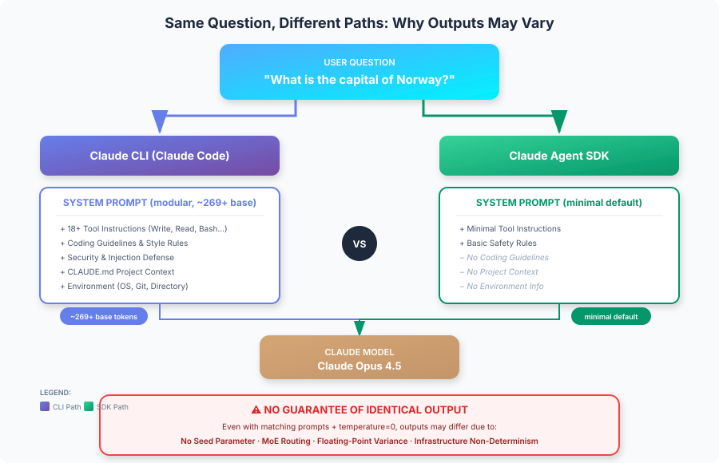

# Claude Agent SDK vs Claude CLI：System Prompt 與輸出一致性

<table width="100%">
<tr>
<td><a href="../">← 回到 Claude Code 最佳實踐</a></td>
<td align="right"></td>
</tr>
</table>

> 英文原文：[`reports/claude-agent-sdk-vs-cli-system-prompts.md`](https://github.com/kevin801221/claude-code-best-practice/blob/main/reports/claude-agent-sdk-vs-cli-system-prompts.md)



---

## 摘要

當你透過 **Claude Agent SDK** 與 **Claude CLI（Claude Code）** 送出同一則訊息（例如「挪威的首都是哪裡？」）時，隨訊息附帶的 system prompt 是根本不同的。CLI 使用**模組化 system prompt 架構**（約 269 個基礎 token，再依啟用的功能有條件地載入額外脈絡），而 SDK 預設使用極簡的 prompt。**即使設定相同，兩者也不保證輸出一致**，因為沒有 seed 參數，而且 Claude 架構本身就有不確定性。

---

## 1. System Prompt 比較

### Claude CLI（Claude Code）

Claude CLI 使用**模組化 system prompt 架構**，基礎 prompt 約 269 個 token，其餘脈絡有條件地載入：

| 元件 | 說明 | 載入時機 |
|-----------|-------------|---------|
| **基礎 System Prompt** | 核心指令與行為 | 一律（約 269 tokens） |
| **工具指令** | 18+ 個內建工具（Write、Read、Edit、Bash、TodoWrite 等） | 一律 |
| **編碼準則** | 程式碼風格、格式規則、安全實務 | 一律 |
| **安全規則** | 拒絕規則、注入防禦、傷害預防 | 一律 |
| **回應風格** | 語氣、冗長度、解釋深度、emoji 使用 | 一律 |
| **環境脈絡** | 工作目錄、git 狀態、平台資訊 | 一律 |
| **專案脈絡** | CLAUDE.md 內容、設定、hooks 設定 | 條件式 |
| **子代理 Prompt** | Plan 模式、Explore 代理、Task 代理 | 條件式 |
| **安全檢視** | 延伸的安全指令（約 2,610 tokens） | 條件式 |

**主要特性：**
- **模組化架構**，有 110+ 個 system prompt 字串依條件載入
- 基礎 prompt 不大（約 269 tokens），總量隨啟用的功能而變
- 包含完整的安全與注入防禦層
- 自動載入工作目錄中的 CLAUDE.md 檔案
- 互動模式下有跨 session 持續的脈絡

### Claude Agent SDK

Agent SDK **預設使用極簡 system prompt**，內含：

| 元件 | 說明 | Token 影響 |
|-----------|-------------|--------------|
| **必要工具指令** | 僅明確提供的工具 | 極小 |
| **基本安全規則** | 最低限度的安全指令 | 極小 |

**主要特性：**
- 預設沒有編碼準則或風格偏好
- 除非明確設定，否則沒有專案脈絡
- 沒有冗長的工具描述
- 需要明確設定才能比照 CLI 的行為

---

## 2. 各介面實際送出什麼

### 範例：「What is the capital of Norway?」

#### 透過 Claude CLI

```
System Prompt：[模組化，約 269+ 基礎 tokens]
├── 基礎 system prompt（約 269 tokens）
├── 工具指令（Write、Read、Edit、Bash、Grep、Glob 等）
├── Git 安全協定
├── 程式碼引用準則
├── 專業客觀性指令
├── 安全與注入防禦規則
├── 環境脈絡（OS、目錄、日期）
├── CLAUDE.md 內容（若存在）[條件式]
├── MCP 工具描述（若有設定）[條件式]
├── Plan/Explore 模式 prompt [條件式]
└── Session／對話脈絡

使用者訊息："What is the capital of Norway?"
```

#### 透過 Claude Agent SDK（預設）

```
System Prompt：[極簡]
├── 必要工具指令（若有提供工具）
└── 基本操作脈絡

使用者訊息："What is the capital of Norway?"
```

#### 透過 Agent SDK（搭配 `claude_code` preset）

```typescript
const response = await query({
  prompt: "What is the capital of Norway?",
  options: {
    systemPrompt: {
      type: "preset",
      preset: "claude_code"
    }
  }
});
```

```
System Prompt：[模組化，與 CLI 相符]
├── 完整的 Claude Code system prompt
├── 工具指令
├── 編碼準則
└── 安全規則

// 注意：除非設定 settingSources，否則仍然不包含 CLAUDE.md
```

---

## 3. 自訂方式

### Claude CLI 的自訂

| 方式 | 命令 | 效果 |
|--------|---------|--------|
| **附加到 prompt** | `claude -p "..." --append-system-prompt "..."` | 在保留預設值的同時加入指令 |
| **取代 prompt** | `claude -p "..." --system-prompt "..."` | 完全取代 system prompt |
| **專案脈絡** | CLAUDE.md 檔案 | 自動載入、持續存在 |
| **輸出風格** | `/output-style [name]` | 套用預先定義的回應風格 |

### Agent SDK 的自訂

| 方式 | 設定 | 效果 |
|--------|---------------|--------|
| **自訂 prompt** | `systemPrompt: "..."` | 完全取代預設值（會失去工具） |
| **Preset 加附加** | `systemPrompt: { type: "preset", preset: "claude_code", append: "..." }` | 保留 CLI 功能 + 自訂指令 |
| **載入 CLAUDE.md** | `settingSources: ["project"]` | 載入專案層級指令 |
| **輸出風格** | `settingSources: ["user"]` 或 `settingSources: ["project"]` | 載入已儲存的輸出風格 |

### 設定比較表

| 功能 | CLI 預設 | SDK 預設 | SDK 搭配 Preset |
|---------|-------------|-------------|-----------------|
| 工具指令 | ✅ 完整 | ❌ 極簡 | ✅ 完整 |
| 編碼準則 | ✅ 有 | ❌ 無 | ✅ 有 |
| 安全規則 | ✅ 有 | ❌ 基本 | ✅ 有 |
| CLAUDE.md 自動載入 | ✅ 有 | ❌ 無 | ❌ 無* |
| 專案脈絡 | ✅ 自動 | ❌ 無 | ❌ 無* |

*需要明確設定 `settingSources: ["project"]`

---

## 4. 輸出一致性的保證

### 關鍵發現：不保證確定性

**Claude Messages API 不提供用於重現的 seed 參數。** 這是架構上的根本限制。

### 阻礙輸出完全一致的因素

| 因素 | 說明 | 可控？ |
|--------|-------------|---------------|
| **不同的 system prompt** | CLI 與 SDK 的預設值不同 | ✅ 可以（透過設定） |
| **浮點運算** | 平行硬體的特性 | ❌ 不行 |
| **MoE 路由** | Mixture-of-Experts 架構的變異 | ❌ 不行 |
| **批次／排程** | 雲端基礎設施差異 | ❌ 不行 |
| **數值精度** | 推論引擎的差異 | ❌ 不行 |
| **模型快照** | 版本更新／變更 | ❌ 不行 |

### Temperature 與取樣

即使設定 `temperature=0.0`（貪婪解碼）：
- 仍然**不保證**完全確定性
- 仍可能因基礎設施因素產生細微差異
- 已知 bug：[Claude CLI 對相同輸入產生非確定性輸出](https://github.com/anthropics/claude-code/issues/3370)

---

## 5. 達到最大一致性

要讓 SDK 與 CLI 的輸出**盡可能接近**：

### Agent SDK 設定

```typescript
import Anthropic from "@anthropic-ai/sdk";

const client = new Anthropic();

// 選項 1：使用 claude_code preset
const response = await client.messages.create({
  model: "claude-sonnet-4-20250514",
  max_tokens: 1024,
  // 盡可能比照 CLI 的 system prompt
  system: "Your exact system prompt matching CLI",
  messages: [
    { role: "user", content: "What is the capital of Norway?" }
  ],
  // 用貪婪解碼取得最大一致性
  temperature: 0
});

// 選項 2：使用 Agent SDK 的 query 函式
import { query } from "@anthropic-ai/agent-sdk";

for await (const message of query({
  prompt: "What is the capital of Norway?",
  options: {
    systemPrompt: {
      type: "preset",
      preset: "claude_code"
    },
    temperature: 0,
    model: "claude-sonnet-4-20250514",
    // 像 CLI 那樣載入專案脈絡
    settingSources: ["project"]
  }
})) {
  // 處理回應
}
```

### CLI 設定

```bash
# 盡可能比照 SDK 的設定
claude -p "What is the capital of Norway?" \
  --model claude-sonnet-4-20250514 \
  --temperature 0
```

### 仍然不保證

即使設定完全相符：

- 不同次執行的輸出可能不同
- SDK 與 CLI 之間的輸出可能不同
- 沒有 seed 參數可以強制重現

---

## 6. 實務意涵

### 何時使用哪個介面

| 使用情境 | 建議介面 | 理由 |
|----------|----------------------|--------|
| 互動式開發 | Claude CLI | 完整工具組、專案脈絡 |
| 程式化整合 | Agent SDK | 細緻控制、可嵌入 |
| 一致的 API 回應 | Agent SDK + 自訂 prompt | 對 system prompt 有更多控制 |
| 批次處理 | Agent SDK | 更適合自動化管線 |
| 一次性任務 | Claude CLI | 設定更快、脈絡立即可用 |

### 設計建議

1. **不要依賴位元級的可重現性**
   - 把應用設計成能容忍輸出的細微差異
   - 使用結構化輸出與驗證

2. **對於需要一致性的生產管線：**
   - 可能的話快取結果
   - 使用結構化輸出搭配 JSON schema 驗證
   - 結合確定性邏輯與驗證
   - 考慮多次生成取共識

3. **要在 SDK 中比照 CLI 行為：**
   ```typescript
   systemPrompt: {
     type: "preset",
     preset: "claude_code",
     append: "Your additional instructions"
   },
   settingSources: ["project", "user"]
   ```

---

## 7. System Prompt 的 Token 影響

| 設定 | 架構 | 備註 |
|---------------|-------------|-------|
| SDK（極簡） | 極簡預設 | 僅必要工具指令 |
| SDK（claude_code preset） | 模組化（約 269+ 基礎） | 與 CLI 相符，隨功能而變 |
| CLI（預設） | 模組化（約 269+ 基礎） | 額外脈絡依條件載入 |
| CLI（含 MCP 工具） | 模組化 + MCP | MCP 工具描述會顯著增加 token |

**注意：** Claude Code 使用模組化架構，含 110+ 個 system prompt 字串。基礎 prompt 約 269 tokens，個別元件則依啟用的功能從 18 到 2,610 tokens 不等。

**意涵：** SDK 的極簡預設讓你有更多脈絡可用於實際任務，但代價是失去 Claude Code 的完整能力。

---

## 8. 總結表

| 面向 | Claude CLI | Agent SDK（預設） | Agent SDK（Preset） |
|--------|------------|--------------------|--------------------|
| **System prompt** | 模組化（約 269+ 基礎） | 極簡 | 模組化（與 CLI 相符） |
| **內含工具** | 18+ 個內建 | 僅在有提供時 | 18+ 個內建 |
| **CLAUDE.md 自動載入** | 是 | 否 | 否（需設定） |
| **編碼準則** | 有 | 無 | 有 |
| **安全規則** | 完整 | 基本 | 完整 |
| **Temperature 控制** | 可 | 可 | 可 |
| **確定性保證** | 無 | 無 | 無 |
| **輸出完全相同？** | 不適用 | 否（相對 CLI） | 更接近，但仍否 |

---

## 9. 結論

**問：同一則訊息在 SDK 與 CLI 分別附帶什麼 system prompt？**

CLI 使用**模組化 system prompt 架構**，基礎 prompt 約 269 tokens，加上 110+ 個依條件載入的元件（工具指令、編碼準則、安全規則、專案脈絡）。SDK 使用**極簡預設**，只有必要的工具指令，不過可以用 `claude_code` preset 設定成比照 CLI 的行為。

**問：有保證輸出完全相同嗎？**

**沒有。** 即使 system prompt 相符、輸入相同、`temperature=0`，也不保證輸出相同，原因包括：

- Claude API 沒有 seed 參數
- 浮點運算差異
- 基礎設施層級的不確定性
- 模型架構（Mixture-of-Experts）的路由變異

**建議：** 把系統設計成能容忍輸出差異，而不是依賴確定性行為。對一致性要求嚴格的應用，請使用結構化輸出、快取與驗證層。

---

## 資料來源

- [Modifying System Prompts - Agent SDK](https://docs.anthropic.com/en/docs/agents-and-tools/claude-code/sdk#modifying-system-prompts)
- [Claude Code CLI Reference](https://docs.anthropic.com/en/docs/agents-and-tools/claude-code/cli)
- [Claude Code Headless Mode](https://docs.anthropic.com/en/docs/agents-and-tools/claude-code/headless)
- [Claude Code Best Practices - Anthropic Engineering](https://www.anthropic.com/engineering/claude-code-best-practices)
- [Claude Messages API Reference](https://docs.anthropic.com/en/api/messages)
- [GitHub Issue #3370: Non-deterministic output](https://github.com/anthropics/claude-code/issues/3370)
- [Claude Code System Prompts Repository](https://github.com/Piebald-AI/claude-code-system-prompts) —— 模組化 prompt 架構分析
- [Why Deterministic Output from LLMs is Nearly Impossible](https://unstract.com/blog/understanding-why-deterministic-output-from-llms-is-nearly-impossible/)

---

*本報告由 Claude Code 使用 Opus 4.5 模型於 2026 年 2 月 3 日產生。*
